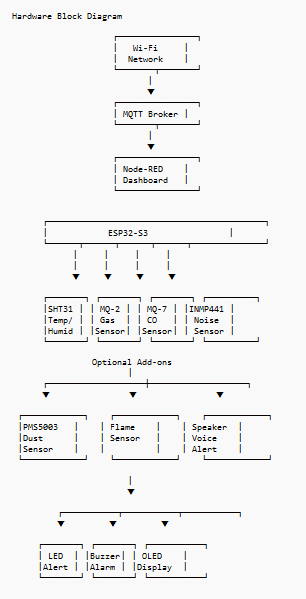

# Site Safety Monitor (IoT)

Low-cost **IoT construction site safety monitoring** system with a live dashboard.

ESP32-S3 reads environmental sensors, publishes over **MQTT**, and a **Node-RED** dashboard shows live status with **SAFE / CAUTION / DANGER** indicators plus **Telegram** alerts.

Based on the project outlook: *Internet of Things (IoT) Based Construction Site Safety Monitoring System*.

## Features

| Area | Details |
|------|---------|
| Temperature & humidity | SHT31 |
| Gas / smoke | MQ-2 |
| Carbon monoxide | MQ-7 |
| Noise | INMP441 (I2S) |
| Local UI / alarms | OLED, LED, buzzer |
| Dashboard | Node-RED gauges + event log |
| Remote alerts | Telegram Bot API |
| Optional | PMS5003 dust, flame sensor, speaker tones |

## Architecture

```
Sensors → ESP32-S3 → Wi-Fi / MQTT → Node-RED Dashboard
                              ↘ Telegram alerts
                         Local LED / buzzer / OLED
```



## Repository layout

```
firmware/site_safety_monitor/   Arduino sketch for ESP32-S3
node-red/flows.json             Importable dashboard + Telegram flow
config/thresholds.json          Shared alert thresholds
wiring/pinout.md                GPIO map
scripts/mosquitto.conf          MQTT broker config
docker-compose.yml              Mosquitto + Node-RED
docs/                           Setup notes, diagrams, components list
```

## Implementation & components

- [Implementation diagram](docs/implementation-diagram.md) · [PNG](docs/assets/implementation-diagram.png)
- [Required components list](docs/required-components-list.md) · [PNG](docs/assets/required-components-list.png)

## Quick start

### 1. MQTT + Node-RED (PC)

**Option A — Docker**

```bash
docker compose up -d
```

- Node-RED: http://localhost:1880  
- Dashboard: http://localhost:1880/ui  
- MQTT: `localhost:1883`

Install dashboard nodes once inside the Node-RED container (or host install):

```bash
docker exec -it site-safety-nodered bash -lc "cd /data && npm install node-red-dashboard node-red-node-ui-table"
docker restart site-safety-nodered
```

**Option B — Local installs**

1. Install [Mosquitto](https://mosquitto.org/) and start with `scripts/mosquitto.conf` (or default listener on 1883).
2. Install [Node-RED](https://nodered.org/), then:

```bash
npm install -g node-red
cd ~/.node-red
npm install node-red-dashboard node-red-node-ui-table
```

3. Start Node-RED (`node-red`), open http://localhost:1880 → **☰ → Import** → select `node-red/flows.json` → **Deploy**.
4. Edit the **Set bot token / chat id** function node with your Telegram bot token and chat ID.

### 2. ESP32-S3 firmware

1. Install [Arduino IDE](https://www.arduino.cc/en/software) + **esp32** board package (Espressif).
2. Board: **ESP32S3 Dev Module**.
3. Libraries (Library Manager):
   - Adafruit SHT31 Library
   - Adafruit SSD1306
   - Adafruit GFX Library
   - PubSubClient
   - ArduinoJson
4. Copy `firmware/site_safety_monitor/config.h.example` → `config.h`.
5. Set `WIFI_SSID`, `WIFI_PASSWORD`, and `MQTT_BROKER` (your PC LAN IP).
6. Wire sensors per [wiring/pinout.md](wiring/pinout.md).
7. Upload `firmware/site_safety_monitor/site_safety_monitor.ino`.

### 3. Telegram bot

1. Talk to [@BotFather](https://t.me/BotFather) → `/newbot` → copy the token.
2. Message your bot, then get your chat id (e.g. via `@userinfobot` or Telegram `getUpdates`).
3. Paste token + chat id into the Node-RED function node and **Deploy**.

## MQTT topics

| Topic | Payload |
|-------|---------|
| `site/safety/telemetry` | JSON snapshot |
| `site/safety/temperature` | °C |
| `site/safety/humidity` | % |
| `site/safety/mq2` | raw ADC |
| `site/safety/mq7` | raw ADC |
| `site/safety/noise` | dB estimate |
| `site/safety/status` | `SAFE` / `CAUTION` / `DANGER` |
| `site/safety/alert` | JSON alert event |

## Thresholds

See [config/thresholds.json](config/thresholds.json). Defaults:

- Temperature caution / danger: **32 °C / 38 °C**
- Noise caution / danger: **85 / 95 dB**
- MQ-2 / MQ-7: raw ADC bands (calibrate on site)

## Safety note

This is a **prototype / educational** early-warning system. Sensors are not certified life-safety instruments. Always follow workplace safety regulations and use approved equipment for compliance-critical monitoring.

## License

Project materials for academic / internship use. Hardware datasheets and third-party tools remain under their own licenses.
