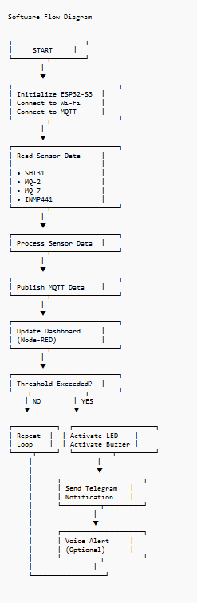
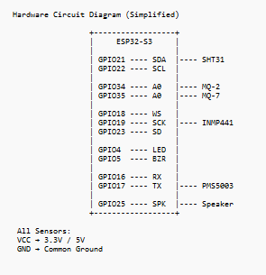

# Full setup guide

## Prerequisites

- ESP32-S3 development board
- Sensors: SHT31, MQ-2, MQ-7, INMP441, 0.96" OLED, LED, buzzer
- Optional: PMS5003, flame sensor, speaker
- PC with Wi-Fi (same network as ESP32)
- Docker Desktop **or** Mosquitto + Node.js/Node-RED
- Telegram account (for alerts)

## Step-by-step

### A. Broker & dashboard

1. From the repo root: `docker compose up -d`
2. Wait ~30s, open http://localhost:1880
3. Install UI nodes if gauges are missing:

```bash
docker exec -it site-safety-nodered bash -lc "cd /data && npm install node-red-dashboard node-red-node-ui-table && node-red-restart || true"
docker restart site-safety-nodered
```

4. Confirm flow **Site Safety Monitor** is present (mounted from `node-red/flows.json`).
5. Edit **Set bot token / chat id** → Deploy.
6. Open http://localhost:1880/ui

### B. Find your PC IP (for MQTT_BROKER)

**Windows PowerShell:**

```powershell
Get-NetIPAddress -AddressFamily IPv4 | Where-Object { $_.InterfaceAlias -notmatch 'Loopback' }
```

Use the LAN address (e.g. `192.168.1.10`) in `config.h`.

### C. Flash firmware

1. `config.h.example` → `config.h`
2. Fill Wi-Fi + MQTT broker IP
3. Arduino IDE → Board **ESP32S3 Dev Module** → correct COM port
4. Upload sketch
5. Serial Monitor @ 115200 — expect `WiFi OK` and `MQTT connect...OK`

### D. Hardware checklist

Follow [wiring/pinout.md](../wiring/pinout.md).

- Common GND
- MQ heaters often need 5 V; warm up ~60 s before trusting readings
- INMP441: L/R pin to GND (left channel) for this firmware
- OLED and SHT31 share I2C bus (GPIO21/22)

### E. Verify end-to-end

1. Gauges move on `/ui`
2. Blow lightly near MQ-2 / raise temperature → status may go CAUTION
3. Alert publishes to `site/safety/alert` → Telegram message within ~10 s

## Software flow



## Circuit reference


